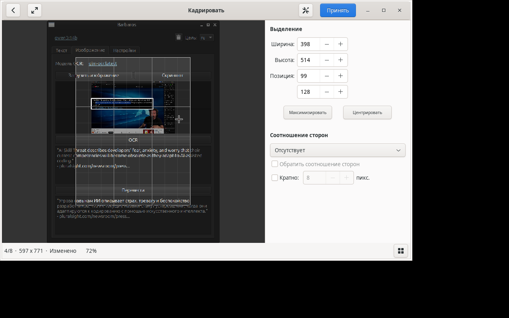
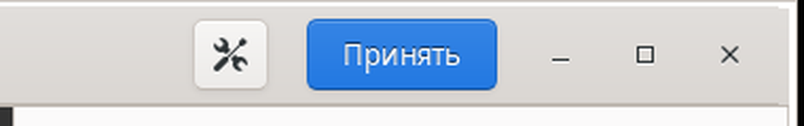
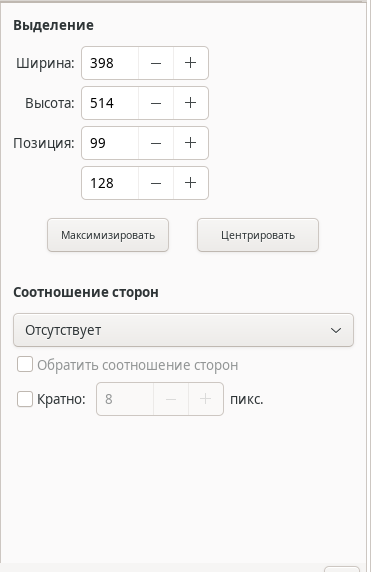
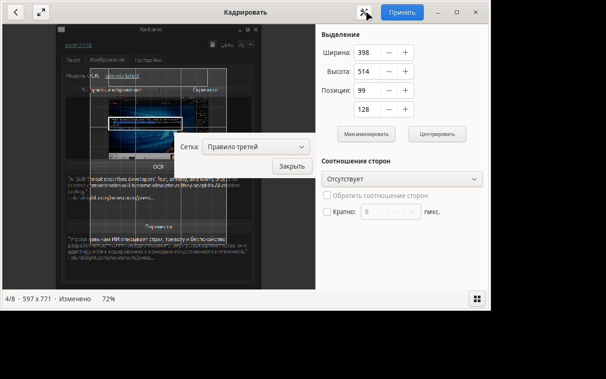
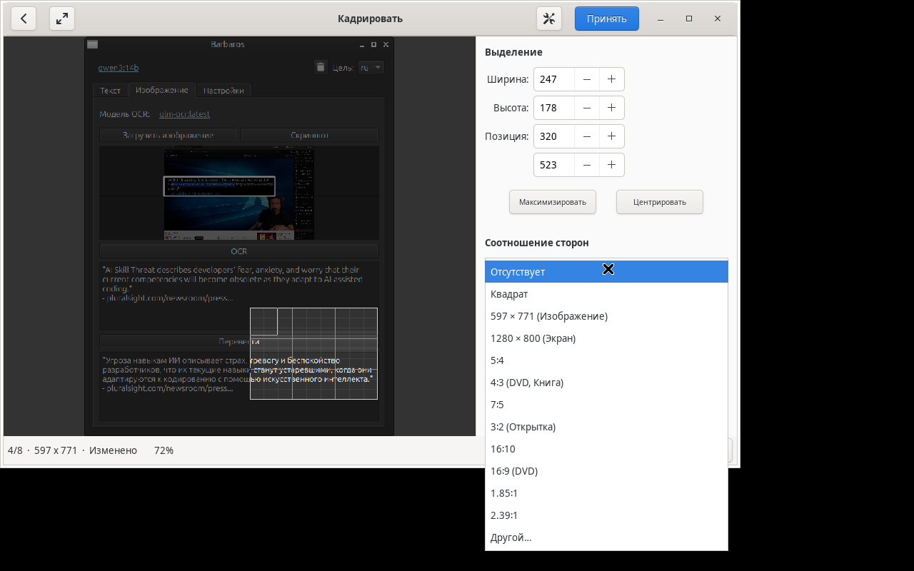
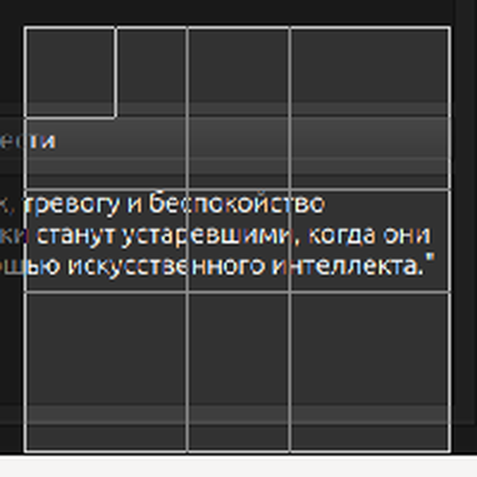
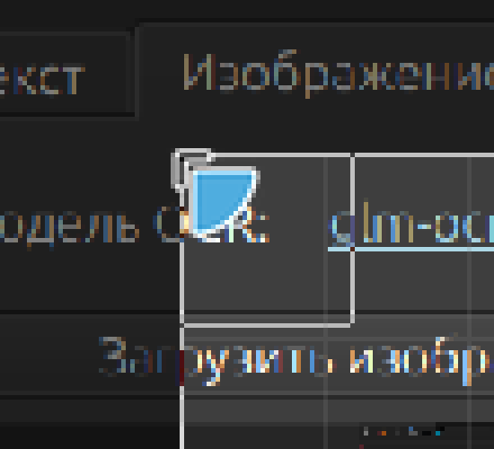
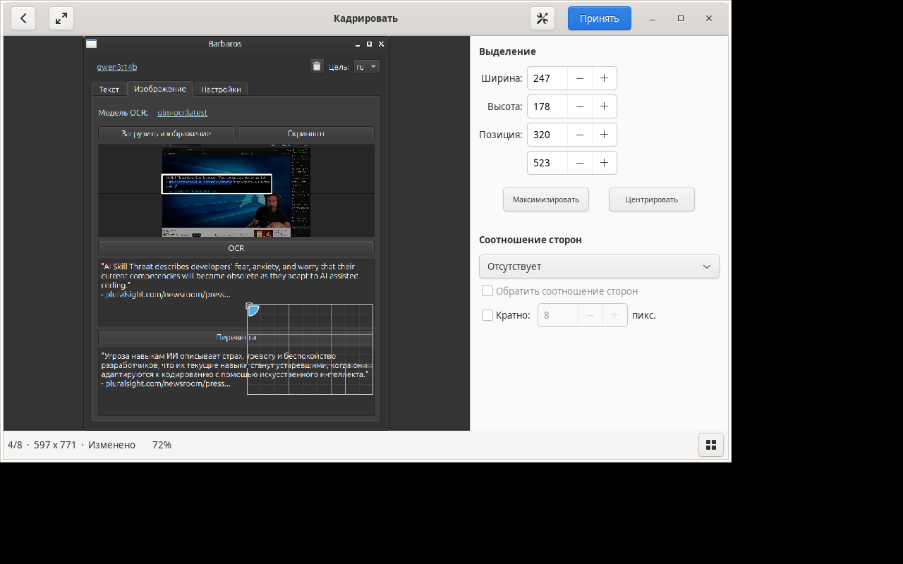

# Crop-селектор Pix — спецификация для переноса

Артефакт описывает crop-инструмент (селектор выделения) из **Pix 3.4.10** настолько подробно,
чтобы его можно было воспроизвести на другом языке программирования или UI-фреймворке.

| | |
|---|---|
| Приложение | Pix (Linux Mint), пакет `pix 3.4.10+zena` |
| Исходники | `linuxmint/pix`, тег `3.4.10` (в `3.4.11` файлы crop не менялись) |
| Снятие | 2026-10-26, изолированный Xvfb 1280×800, тема Adwaita/Mint-Y, локаль RU |
| Метод | чтение исходников + прогон GUI мышью через XTEST + попиксельный разбор скриншотов |
| Применимость | GTK3/Cairo-реализация Pix; ниже — framework-agnostic семантика и константы |

> **Важно:** в `linuxmint/xviewer` инструмента crop нет вообще (ни в 3.4.16+zena, ни в
> 3.4.17+mint27: в меню Edit только Undo/Copy/Flip/Rotate/Trash; в переводах и бинарнике
> нет строк crop; feature requests #21, #63, #233, #237 открыты с 2016 г.). Поэтому
> артефакт описывает **Pix** — приложение Linux Mint, в котором crop-селектор реально есть.

## Содержание

- [1. Что это по UX](#1-что-это-по-ux)
- [2. Внешний вид и раскладка](#2-внешний-вид-и-раскладка)
- [3. Модель состояния](#3-модель-состояния)
- [4. Координаты и пересчёты](#4-координаты-и-пересчёты)
- [5. Алгоритм отрисовки](#5-алгоритм-отрисовки)
- [6. Взаимодействие](#6-взаимодействие)
- [7. Ограничения выделения](#7-ограничения-выделения)
- [8. Панель, диалог, настройки](#8-панель-диалог-настройки)
- [9. Accept / Cancel](#9-accept--cancel)
- [10. Клавиатура](#10-клавиатура)
- [11. Краевые случаи и известные странности](#11-краевые-случаи-и-известные-странности)
- [12. Чек-лист переноса](#12-чек-лист-переноса)
- [13. Источники](#13-источники)
- [Приложение A. Константы](#приложение-a-константы)
- [Приложение B. Скриншоты](#приложение-b-скриншоты)

---

## 1. Что это по UX

Crop — это **не отдельный диалог**, а режим («file tool») внутри просмотрщика:

1. Пользователь открывает картинку в viewer.
2. Активирует инструмент: `Shift+C` либо кнопка «Edit file» (иконка палитры, `e`) →
   в боковой панели toolbox → секция **Format** → иконка **Crop**
   (`image-crop-symbolic`, tooltip «Crop»/«Кадрировать»).
3. Приложение загружает **полноразмерное текущее изображение** (включая несохранённые правки)
   и показывает его в viewer в режиме «fit, если больше окна»; в боковой панели вместо toolbox
   появляется панель параметров crop; в headerbar — кнопки режима.
4. На изображении появляется прямоугольное выделение: снаружи затемнено, внутри — исходная
   яркость, поверх — сетка, если включена.
5. Создание/перемещение/ресайз — мышью; точные значения — спинбоксами; пропорции/сетка —
   панелью и диалогом.
6. **Accept** (кнопка в headerbar) применяет crop **в память** (файл не перезаписывается),
   изображение становится modified; **Cancel** (стрелка «назад» / `Escape`) возвращает
   изображение, бывшее до входа в режим.

Главные отличия от «GIMP-style», к которым привыкают: **у выделения нет видимых квадратных
ручек**. Ручки невидимы (40 px зоны по краям/углам), их существование выдают только курсор
и подсветка-скобка при наведении. Рамка и сетка рисуются в режиме Difference (инверсия цвета),
поэтому видны на любом изображении.

---

## 2. Внешний вид и раскладка

### 2.1 Окно в режиме crop



Headerbar (высота ~48 px, CSD):



- слева: «назад» (отмена инструмента, остаёмся в viewer), «fullscreen»;
- центр: заголовок = название инструмента, без имени файла (`Crop` / `Кадрировать`);
- справа: кнопка **Options** (иконка `xsi-tools-symbolic`, tooltip «Options»), затем
  **Accept** — кнопка suggested-action (в Mint/Adwaita — синяя), затем системные кнопки окна;
- кнопка меню (гамбургер) на время режима **скрыта**;
- кнопки зума в headerbar **скрыты** (инструмент не «zoomable»), хотя зум с клавиатуры
  продолжает работать.

Viewer (слева) и боковая панель (справа): ширина панели — минимум 365 logical px
(в примере 371), она замещает toolbox; панель скроллируется по вертикали. Зум в статусбаре —
текущий масштаб изображения.

Statusbar в режиме crop: `позиция в списке · W × H · Изменено · зум%` — важно:
**активация инструмента временно ставит флаг modified** и статус показывает «Изменено»;
Cancel может снять флаг, если до этого несохранённых правок не было.

Фон viewer вне изображения — серый `0.2` (`#333333`), задан кодом (`GRAY_VALUE 0.2`),
не темой.

### 2.2 Оверлей выделения

Наблюдаемые параметры (совпадают с кодом):

| Элемент | Значение |
|---|---|
| Затемнение вне выделения | чёрный, alpha **0.50**, поверх **только области изображения** (не всего widget’а) |
| Яркость внутри выделения | исходное изображение без затемнения |
| Рамка выделения | 1 **device** px, выровнена по пикселям, цвет = инверсия подложки (Difference с белым): `out = 255 - in` |
| Сетка | 1 device px, Difference с белым и заданной alpha; клипается по выделению |
| Видимые ручки | **нет**; при наведении на ручку рисуется 1 px «скобка» (Difference) по внутренней границе её зоны |
| Во время перетаскивания | затемнение **исчезает** (изображение яркое целиком), рамка/сетка остаются |
| Пустое выделение (w=0 или h=0) | оверлей полностью скрыт (ни затемнения, ни рамки, ни сетки) |

Точные формулы отрисовки — в §5.

### 2.3 Панель параметров (sidebar)



Сверху вниз (все отступы из `crop-options.ui`):

- контейнер: padding **12 px**, между блоками **24 px**;
- заголовок **Selection / Выделение** (жирный);
- `Width:` → integer spin, `width_chars=5`, `−/+`, шаг 1;
- `Height:` → spin;
- `Position:` → два spin’а в две строки: X, затем Y (без подписи);
- две кнопки в ряд `Maximize` / `Center` (spread, border 6, margin-top 6);
- заголовок **Aspect ratio / Соотношение сторон** (жирный);
- combo со списком пропорций (растянут по ширине);
- **скрытая строка** `W : H` (два spin через `:`) — видна только при выборе «Other…»;
- чекбокс `Invert aspect ratio` (активен только когда пропорция включена);
- чекбокс `Multiple of:` + spin (1…100000, default 8) + метка `px`; спин активен только
  при включённом чекбоксе.

Внутри строк: spacing 6; строки таблицы 6×6. Все подписи с мнемониками
(`_Width`, `Heigh_t`, `_Position`, `I_nvert`, `M_ultiple of`, `_Grid`).

Кнопки `Maximize` / `Center`:

- **Maximize**: `pos = (0,0)`; ширина = полная ширина изображения; если включена пропорция —
  высота = `round(width/ratio)` (и если такой прямоугольник не влезает — вместо ширины
  берётся полная высота и ширина = `round(height*ratio)`); затем центрирование.
  Пример с квадратом: 597×771 → 597×597 @ (0,87).
- **Center**: `pos = floor((W−w)/2), floor((H−h)/2)`; размер не меняется.

### 2.4 Диалог сетки



Отдельное **немодальное** окно (width_request 300, не ресайзится, border 6, title
«Options/Параметры»): `Grid:` + combo (`None`, `Rule of Thirds`, `Golden Sections`,
`Center Lines`, `Uniform`) + кнопка `Close`. Изменение сетки применяется сразу к селектору.
На скриншоте нет оконных декораций — это артефакт headless-Xvfb без WM; в реальной сессии
у диалога будет заголовок.

### 2.5 Список пропорций



Полный порядок (enum = порядок combo): `None`, `Square`, `W × H (Image)` (динамически,
текущий размер), `W × H (Screen)`, `5:4`, `4:3 (DVD, Book)`, `7:5`, `3:2 (Postcard)`,
`16:10`, `16:9 (DVD)`, `1.85:1`, `2.39:1`, `Other…`. Выбор «Image/Screen» фиксируется
числами на момент активации инструмента.

### 2.6 Сетка «Золотые сечения» (пример)



### 2.7 Пример Maximize с квадратной пропорцией


---

## 3. Модель состояния

```text
CropState
  image: { W, H }                 # размер полного изображения, px
  view:  { zoom, imageArea, visibleArea }  # как в viewer
  sel: Rect                       # ВСЕГДА в пикселях изображения, целые
  activeArea: AreaType|null       # зона под курсором/взятая в драг
  pressed: bool
  dragging: bool
  dragStartSel: Rect              # sel в момент press
  dragStart: (x,y)                # координаты указателя в selector-пространстве
  ratio: { enabled: bool, value: float }   # value = w/h
  bind:  { enabled: bool, factor: int }
  grid:  NONE | THIRDS | GOLDEN | CENTER | UNIFORM
  maskVisible: bool               # = (sel.w>0 && sel.h>0)
  autoScrollTimer
```

Инварианты:

- `0 ≤ sel.x`, `sel.x+sel.w ≤ W`, аналогично по Y (для режима без пропорции; с пропорцией —
  тоже, но достигается «сжатием»).
- `sel.w ≥ 0`, `sel.h ≥ 0`; при активном селекторе после инициализации `sel.w>0 && sel.h>0`.
- Экранные координаты не хранятся — только пересчитываются из `sel` и `zoom`.
- Настройки (`ratio`, `bind`, `grid`) переживают закрытие инструмента; геометрия выделения — нет.

Начальное выделение при активации (наблюдено: 597×771 → 398×514 @ (99,128)):

- без пропорции: `w = W*2/3`, `h = H*2/3`, центрирование (округление вниз);
- с пропорцией: взять `w = W*2/3`, `h = round(w/ratio)`; если не влезает —
  `h = H*2/3`, `w = round(h*ratio)`; центрировать.

---

## 4. Координаты и пересчёты

Три системы:

1. **Изображение (real)** — пиксели исходника; в ней хранится `sel` и выполняется crop.
2. **Selector** — координаты виджета viewer’а после масштабирования (используются для
   отрисовки и hit-test).
3. **Widget/screen** — для событий мыши; добавляется смещение `visibleArea` (скролл)
   и `imageArea` (позиция картинки).

```text
to_selector(v)        = round(zoom * v)
to_real(v)            = round(v / zoom)
sel_screen            = ( imageArea.x - visibleArea.x + to_selector(sel.x),
                          imageArea.y - visibleArea.y + to_selector(sel.y),
                          to_selector(sel.w), to_selector(sel.h) )
```

- `zoom` — текущий масштаб viewer’а; инструмент ставит `fit-if-larger` при входе и `LOW`
  quality интерполяции (после выхода возвращаются настройки пользователя).
- Пересчёт компонентов прямоугольника независимый (round каждого), поэтому на «нечётном»
  зуме возможно расхождение в 1 px — это ожидаемо, не баг.
- При resize окна / изменении зума пересчитывается только экранный прямоугольник;
  `sel` в пикселях изображения не меняется.
- На HiDPI: толщины линий считать в device px (`cairo_device_to_user_distance(1,1)`
  в оригинале), т.е. pen толщиной `1/scale` logical px.

---

## 5. Алгоритм отрисовки

Порядок (полностью соответствует `gth_image_selector_draw` + `_cairo_paint_grid` +
`event_area_paint`):

```text
draw():
    draw_viewer_background()            # серый 0.2 (#333)
    if image is null: return
    draw_image_frame()                  # рамка viewer'а
    if not maskVisible:
        draw_image_full()               # никакого оверлея
        return
    if dragging:
        draw_image_full()               # БЕЗ затемнения
    else:
        draw_image_full()
        overlay_black(alpha=0.5) over imageArea      # затемнение
        draw_image_clipped(sel_screen)               # вернуть яркость внутри
    draw_selection_overlay()            # рамка + сетка + подсветка ручки, клип по sel_screen
```

`draw_selection_overlay`:

```text
save()
clip(sel_screen expanded by 1)          # сетка не вылезает за выделение
line_width = 1 device px
operator  = DIFFERENCE
stroke_rect(sel_screen + 0.5, w-0.5, h-0.5) with white       # рамка
paint_grid(sel_screen, gridType)
if hoveredArea != null and hoveredArea != INTERIOR:
    paint_handle_bracket(hoveredArea) with white, DIFFERENCE
restore()
```

Сетка (координаты — внутри `sel_screen`, все линии 1 px, `+0.5` для пиксельной чёткости,
вертикальные линии идут от `y+1.5` до `y+h-0.5`, горизонтальные — от `x+1.5` до `x+w-0.5`,
т.е. с отступом ~1 px от рамки):

| Тип | Линии | Alpha (Difference-white) |
|---|---|---|
| NONE | только рамка | — |
| THIRDS | 2 вертикальные на `i/3` (i=1,2) + 2 горизонтальные; плюс «слабые» на `i/9` (i=1..8, кроме кратных 3) | 0.60 / 0.10 |
| GOLDEN | `d = 0.382033… * w`; вертикали `x+d` и `x+w−d` (вторая — если `d < w/2`); горизонтали аналогично | 0.60 |
| CENTER | 1 вертикаль и 1 горизонталь по центру + «слабые» на `1/4` и `3/4` | 0.60 / 0.10 |
| UNIFORM | три слоя с шагом 100 px (0.40), 50 px (0.20, без кратных 100), 10 px (0.10, без кратных 50); слой рисуется только если `w/step ≤ 50` (в оригинале проверяется только ширина) | 0.40/0.20/0.10 |

`0.382033… = φ/(1+2φ)`, `φ=1.6180339887`.

Подсветка ручки (наблюдено и совпадает с кодом): берётся прямоугольник зоны ручки (см. §6),
и рисуются 1-px линии по его **внутренним** сторонам (не по внешним, совпадающим с рамкой):

- угол — 2 линии («уголок»), например top-left: вертикаль на `sel.x + b − 2`, горизонталь
  на `sel.y + b − 2`, длина ~`b−2`;
- сторона — 3 линии («скоба»): для top — вертикали на `sel.x + b − 1` и `sel.x + w − b`,
  горизонталь на `sel.y + b − 2` между ними.
- визуально это инверсия (Difference) на 1 px, толщина как у сетки. Точные `−1/−2` —
  следствие `+0.5` выравнивания; при переносе достаточно «внутренняя граница зоны, 1 px».





Замечания:

- Difference — это не «полупрозрачный белый»: цвет зависит от картинки. На тёмном
  получается светлая линия, на светлом — тёмная. Это осознанное решение Pix, а не тема.
- Затемнение рисуется **по прямоугольнику изображения**, поэтому серый фон viewer’а
  не темнеет.

---

## 6. Взаимодействие

### 6.1 Hit-test зоны

Координаты — в selector-пространстве. `b` = размер зоны:

```text
b = 40
if sel_w < 120: b = sel_w / 3
if sel_h < 120: b = sel_h / 3     # в оригинале второе условие перекрывает первое
b = max(b, 3)
```

Зоны (приоритет проверки: углы → стороны → внутренность; всё, что внутри изображения,
но вне выделения — «создание нового»):

- 8 зон: 4 угла `b×b`, 4 стороны — полосы `b` вдоль краёв (между углами);
- INTERIOR — прямоугольник выделения, расширенный на 1 px (чтобы легче «взять»);
- OUTSIDE (в пределах изображения) — режим создания.

Курсоры (стандартные resize-курсоры направления; тема может рисовать по-своему):

| Зона | Cursor |
|---|---|
| вне выделения / нет маски | crosshair |
| INTERIOR | move/fleur |
| top / bottom | вертикальный resize (N/S) |
| left / right | горизонтальный resize (W/E) |
| top-left / bottom-right | NWSE-resize |
| top-right / bottom-left | NESW-resize |

Курсор обновляется на каждом движении без кнопки, только когда `maskVisible`.

### 6.2 Машина событий

```text
on_motion(x,y):
    if not maskVisible: return
    if not dragging:
        activeArea = hit_test(x + visibleArea)
        cursor = cursor_for(activeArea)
        return

    # dragging
    dx = to_real(px - pxStart)
    dy = to_real(py - pyStart)
    newSel = real(dragStartSel)
    area = activeArea

    # 1) пересечение противоположной стороны → «переворот» якоря
    if area is left-side and dx > newSel.w:
        newSel.x += newSel.w; dx = -2*newSel.w + dx; area = right-side
    if area is right-side and -dx > newSel.w: ... (симметрично)
    if area is top-side and dy > newSel.h:  ... ; area = bottom-side
    if area is bottom-side and -dy > newSel.h: ...

    # 2) применение движения к выбранной ручке (см. §7)
    resize_by(area, dx, dy)

    # 3) autoscroll, если указатель вне widget’а (см. 6.3)

on_press(button=1, inside image):
    if activeArea == null:          # клик вне выделения
        sel = Rect(real_point, 1, 1)    # 1×1
        activeArea = BOTTOM_RIGHT
        maskVisible = true
    pressed = true
    dragging = true                  # затемнение сразу выключается
    dragStartSel = sel
    dragStart = point

on_release:
    if autoscroll timer: stop
    dragging = false; pressed = false
    re-run hover hit-test (курсор)
    # затемнение и маска возвращаются
```

Следствия, которые нужно воспроизвести:

- **клик без драга вне выделения даёт выделение 1×1** (а не «ничего»);
- клик внутри выделения ничего не меняет (move на 0);
- **Drag threshold** в оригинале фактически не работает: `dragging` ставится уже на press,
  поэтому затемнение пропадает сразу при нажатии (наблюдено);
- «переворот» ручки: потянули левую границу вправо за правую — ручка становится правой,
  выделение растёт от правой стороны (с курсором правой ручки);
- при отпускании маска возвращается (если `sel` не пустой).

### 6.3 Autoscroll

При драге за пределами widget’а viewer’а: таймер **30 мс**, на каждом тике
`step_x = (расстояние указателя за краем)/2`, аналогично `step_y`; скроллбары сдвигаются
на step (с клампом), `dragStart`-координаты тоже сдвигаются на step, выделение пересчитывается.
Останавливается, когда указатель вернулся внутрь или кнопка отпущена.

### 6.4 Зум/скролл

Во время crop работает обычный зум viewer’а (`+`, `-`, `1`, `x`, `Shift+X`, `W/H`-варианты),
скроллбары и автоскролл; выделение хранится в пикселях изображения и корректно
пересчитывается. Панорамирование мышью недоступно — инструмент перехватывает drag.

---

## 7. Ограничения выделения

### 7.1 Без пропорции (use_ratio = false)

Все изменения сразу клампятся к `[0,W]×[0,H]`:

- move: `x = clamp(x, 0, W−w)`, `y = clamp(y, 0, H−h)`;
- resize стороны/угла: противоположная сторона закреплена; рост останавливается на границе;
- `w,h ≥ 0`; отрицательные размеры получаются только через «переворот» ручки (см. §6.2).

### 7.2 С пропорцией

`ratio = w/h` (или `h/w`, если включён `Invert`). При изменении любого размера вторая
сторона выводится из пропорции.

- **Стороны** (пример top): `h -= dy`, `w = round(h * ratio)` (правая граница «растёт»
  вправо от левого края — в оригинале так, даже если боковая ручка); снизу/справа/слева —
  симметрично.
- **Углы**: выбирается доминирующая ось по положению указателя относительно диагонали,
  проходящей через противоположный угол:
  `semiplane = (a ≤ b ≤ a+π)`, где `a = atan((y1−y2)/(x2−x1))`,
  `b = atan((y1−py)/(px−x1))`; если true — вторая ось выводится из `dx`, иначе из `dy`.
- **Выход за границы**: перед применением выделение «сжимается» с сохранением пропорции
  (для каждой ручки свой набор проверок). Если и после этого прямоугольник не влезает —
  изменение **отклоняется** (выделение остаётся прежним).
- Смена пропорции: сохраняется текущая ширина, высота = `round(w/ratio)`; при переключении
  `Invert` — «естественный обмен»: новая ширина = текущая высота, затем
  высота = `round(w/ratio)`, а если не влезает — откат к сохранению ширины и уменьшению
  высоты.
- `Image` = `W/H`, `Screen` = размер экрана на момент активации.

### 7.3 Кратность (`Multiple of`)

После расчёта `w,h`:

```text
snap(v, f) = nearest_multiple(v, f), при равенстве расстояний — вверх
w = snap(w, f); h = snap(h, f)     # f ≥ 1; f=1 — без эффекта
```

В оригинале применяется и к спинбоксам, и к мыши.

### 7.4 Спинбоксы

При каждом изменении выделения пересчитываются диапазоны:
`X: 0…W−w`, `Y: 0…H−h`, `Width: 0…W−x`, `Height: 0…H−y`; значения пишутся без рекурсии
(signals blocked). Изменение width/height при включённой пропорции автоматически меняет
вторую сторону.

---

## 8. Панель, диалог, настройки

### 8.1 Сохранение настроек (GSettings `org.x.pix.crop`)

| Ключ | Тип | Default |
|---|---|---|
| `grid-type` | enum | `thirds` |
| `aspect-ratio` | enum | `none` |
| `aspect-ratio-invert` | bool | false |
| `aspect-ratio-width` | int | 1 |
| `aspect-ratio-height` | int | 1 |
| `bind-dimensions` | bool | false |
| `bind-factor` | int | 8 |

Читаются при активации инструмента, **записываются при уничтожении панели (и Accept,
и Cancel)**. Поэтому выбранная сетка/пропорция/кратность видна при следующем открытии,
а геометрия выделения всегда создаётся заново (2/3, по центру).

### 8.2 Обновления в реальном времени

- спинбоксы ↔ выделение (двусторонняя синхронизация);
- combo пропорции: меняет ratio и пересчитывает выделение; «Other…» показывает строку W:H
  (ввод чисел применяется сразу); `Invert` пересчитывает;
- чекбокс кратности включает/выключает спин фактора;
- диалог сетки меняет `grid-type` немедленно (сам диалог немодальный).

---

## 9. Accept / Cancel

### Accept (кнопка в headerbar)

```text
if sel.w == 0 or sel.h == 0: return          # no-op
task = async("Applying changes"):
    dst = copy_subsurface(source_full_res, sel) # sel уже в пикселях изображения
on done:
    viewer_page.set_image(dst, add_to_history=true)
    hide_options()                             # инструмент выключается
```

- crop применяется к **полноразмерному текущему изображению** (включая предыдущие
  несохранённые правки, `get_original` при `modified` берёт modified image), а не к файлу
  на диске;
- результат остаётся **несохранённым**: title `file [modified]`/`[изменён]`, Save (`Ctrl+S`)
  нужен отдельно; в историю добавляется запись (Undo возможен);
- после применения headerbar/sidebar возвращаются в обычный viewer-режим, fit/zoom quality
  восстанавливаются.

### Cancel (стрелка «назад», `Escape`, `BackSpace`, кнопка деактивации инструмента)

```text
reset_image(): viewer_page.reset()   # восстановить последнее изображение из истории
hide_options(); reset_viewer_tool()  # вернуть image-dragger, fit-if-larger, настройки зума
```

- восстанавливается изображение, бывшее до входа в crop (в т.ч. несохранённые правки,
  если они были);
- выделение и настройки зума/скролла сбрасываются;
- если до активации несохранённых правок не было, флаг modified снимается (наблюдено).

### Особенности

- активация инструмента сама по себе ставит modified (изображение подменяется на
  полноразмерное) — «Изменено» в статусбаре видно ещё до Accept;
- кнопка Accept = `changes_image ? "Accept" : "Close"`; для crop всегда Accept;
- при закрытии окна с modified Pix спросит сохранение (стандартное поведение приложения,
  не инструмента).

---

## 10. Клавиатура

- открыть crop: **Shift+C**;
- открыть/закрыть toolbox «Edit file»: **E** (иконка палитры в headerbar);
- отмена: **Escape** или **BackSpace** (глобальный действие «browser-mode»: если в sidebar
  активен инструмент — он деактивируется, остаёмся в viewer);
- зум viewer’а: `+`, `-`, `1`, `x`, `Shift+X`, `w`, `Shift+W`, `h`, `Shift+H`;
- стрелки/PageUp/PageDown в viewer’е листают файлы; в режиме инструмента навигация
  по файлам скрыта/недоступна из headerbar (в оригинале действия навигации отключаются
  на время инструмента);
- клавиш «подвинуть выделение на 1 px» нет (только спинбоксы).

---

## 11. Краевые случаи и известные странности

Их полезно знать, чтобы при порте осознанно сделать «как в Pix» или «как правильно»:

1. **Размер зон ручек**: второе условие (`height/3`) перекрывает первое (`width/3`) — для
   вытянутых маленьких выделений зоны могут получиться нелогичными. Разумная замена:
   `b = clamp(min(40, min(w,h)/3), 3, 40)`.
2. **Коррекция выхода за границы при включённой пропорции** содержит повторяющиеся блоки
   и сравнения `x` с `surface_area.y` (похоже на опечатки); поведение местами
   «залипает»/отклоняет изменение. При порте лучше реализовать чистый алгоритм: сжать
   прямоугольник с сохранением пропорции относительно закреплённой стороны.
3. **Drag threshold (1 px) объявлен, но не используется** — `dragging` включается на press;
   затемнение пропадает сразу.
4. **Диалог Options немодальный** и не закрывается при отмене инструмента: после `Escape`
   он может остаться на экране (наблюдено). Лучше закрывать его вместе с инструментом.
5. **Пропорция «Screen»** фиксирует размер экрана на момент активации (не обновляется при
   перемещении окна).
6. **Округление**: хранение в пикселях изображения + пересчёт в экранные даёт дрейф до 1 px
   при повторных сменах зума; для серьёзных инструментов лучше хранить `sel` в пикселях
   изображения и никогда не писать обратно округлённые экранные значения без нужды.
7. **Mask при пустом выделении**: оверлей не рисуется вовсе, поэтому после первого клика
   без протяжки видно выделение 1×1 (это нормальное поведение Pix, но пользователи могут
   принять за баг).
8. **Минимальное изображение**: для изображений меньше ~3 px зоны ручек схлопываются;
   нужен отдельный fallback (например, только INTERIOR + CREATE).
9. Оригинал не поддерживает поворот выделения, «золотое сечение» как ограничение
   пропорции, блокировку позиции и т.п. — не усложняйте порт.

---

## 12. Чек-лист переноса

### 12.1 Каркас

1. Реализовать overlay-инструмент поверх viewer’а: `on_paint`, `on_mouse_down/move/up`,
   `on_wheel/zoom`, `on_resize`, `on_key`.
2. Хранить `sel` в пикселях изображения; на отрисовке считать `sel_screen` по `zoom`
   и смещениям.
3. Панель параметров — отдельный виджет/скоуп с двусторонней привязкой к `sel`.
4. Accept/Cancel — команды уровня приложения: Accept копирует subsurface, помечает документ
   изменённым; Cancel восстанавливает предыдущее изображение из истории.

### 12.2 Маппинг на фреймворки

- **Qt / PySide6**: `QWidget` + `setMouseTracking(True)` + `paintEvent`;
  `QPainter.setCompositionMode(QPainter.CompositionMode_Difference)`;
  `QPen` толщиной `1/devicePixelRatioF()`; `QImage.copy(rect)` для Accept;
  `QSpinBox/QComboBox/QCheckBox` в `QScrollArea`; `Qt.SizeFDiagCursor` и т.п.;
  `QTimer(30)` для autoscroll; линии рисовать на `x+0.5`.
- **Web Canvas**: `globalCompositeOperation='difference'`, `ctx.lineWidth = 1/devicePixelRatio`,
  `ctx.clip(sel)`, `drawImage` масштабированной картинки; маска — `fillRect`
  с `rgba(0,0,0,.5)`.
- **Compose/Skia**: `drawIntoCanvas { it.saveLayer(..., BlendMode.Difference) }`,
  `clipRect`, `Path`; маска — `drawRect(Black.copy(alpha=.5f))`.
- **Unity/любой immediate-mode**: тот же порядок: фон → изображение → затемнение → клип →
  рамка/сетка/скобка.

### 12.3 Тесты (то, что реально проверялось в Pix и что стоит зафиксировать)

- Начальное выделение: 2/3, по центру, для портрета/ландшафта/квадрата/1×1/огромного
  изображения.
- Ресайз всеми 8 ручками в обе стороны; переворот через противоположную сторону; упор
  в каждую границу.
- Move: кламп по всем четырём краям; клик без драга снаружи → 1×1.
- Пропорции: каждая из списка; кастомная; invert; смена пропорции при выделении у границы;
  maximize при пропорции, которая не влезает.
- Кратность: 2, 8, 100; поведение на границах и при малых размерах (1, 2, 3 px).
- Отрисовка: mask 0.5; рамка = инверсия; alpha сетки по типам; золотое сечение/центр/
  равномерная — сверка позиций линий; отсутствие ручек; скобка при hover; отсутствие
  затемнения во время драга.
- Ввод: все курсоры, приоритет углов над сторонами; autoscroll у краёв; зум 1%, 100%, 800%;
  resize окна.
- Данные: Accept → точный rect crop; размер/пиксели результата; modified; Undo;
  Cancel → исходное изображение; настройки переживают Cancel и перезапуск.
- Нефункциональные: плавность драга на 50 Мп изображении (не декодировать заново каждый
  кадр, кэшировать scaled image), отсутствие утечек на 1000 открытий/закрытий, память
  при больших выделениях.

---

## 13. Источники

Pix 3.4.10; в 3.4.11 эти файлы не менялись (проверено сравнением тегов):

- Контроллер инструмента:
  [`extensions/file_tools/gth-file-tool-crop.c`](https://github.com/linuxmint/pix/blob/3.4.10/extensions/file_tools/gth-file-tool-crop.c)
- Селектор (вся логика/рисование):
  [`pix/gth-image-selector.c`](https://github.com/linuxmint/pix/blob/3.4.10/pix/gth-image-selector.c)
- Сетка и рисование утилитами Cairo:
  [`pix/cairo-utils.c`](https://github.com/linuxmint/pix/blob/3.4.10/pix/cairo-utils.c) (`_cairo_paint_grid`)
- Панель параметров:
  [`extensions/file_tools/data/ui/crop-options.ui`](https://github.com/linuxmint/pix/blob/3.4.10/extensions/file_tools/data/ui/crop-options.ui)
- Настройки:
  [`data/gschemas/org.x.pix.crop.gschema.xml`](https://github.com/linuxmint/pix/blob/3.4.10/data/gschemas/org.x.pix.crop.gschema.xml)
- Горячие клавиши:
  [`extensions/file_tools/callbacks.c`](https://github.com/linuxmint/pix/blob/3.4.10/extensions/file_tools/callbacks.c)
- Chrome (headerbar/sidebar/toolbox):
  [`pix/gth-toolbox.c`](https://github.com/linuxmint/pix/blob/3.4.10/pix/gth-toolbox.c),
  [`pix/gth-sidebar.c`](https://github.com/linuxmint/pix/blob/3.4.10/pix/gth-sidebar.c),
  [`pix/gth-browser.c`](https://github.com/linuxmint/pix/blob/3.4.10/pix/gth-browser.c)
- Справка:
  [`help/C/edit-resize-crop.page`](https://github.com/linuxmint/pix/blob/3.4.10/help/C/edit-resize-crop.page)

---

## Приложение A. Константы

Машиночитаемый набор констант — в [`constants.yaml`](constants.yaml).

---

## Приложение B. Скриншоты

Сняты в изолированном Xvfb 1280×800 без оконного менеджера (поэтому у диалога сетки нет
оконных декораций) на Pix 3.4.10+zena, тема Adwaita/Mint-Y, локаль RU. Все пиксельные
значения оверлея (0.5, 1 px, 0.60/0.10, 40 px, 2/3) не зависят от темы.

| Файл | Что показано |
|---|---|
| `overview.png` | общий вид crop-режима: выделение, затемнение, сетка, панель, headerbar |
| `headerbar.png` | headerbar режима: назад, fullscreen, заголовок, Options, Accept |
| `sidebar-panel.png` | панель параметров: Selection, Aspect ratio, кратость |
| `hover-corner.png` | наведение на левый верхний угол: курсор-угол и внутренняя скобка |
| `drag-mask-off.png` | создание выделения: пока кнопка нажата, затемнение отключено |
| `aspect-ratio-popup.png` | полный список пропорций |
| `grid-dialog.png` | диалог выбора сетки |
| `grid-golden.png` | сетка «Золотые сечения» |
| `maximized-square.png` | Maximize при квадратной пропорции: 597×597 @ (0,87) |
